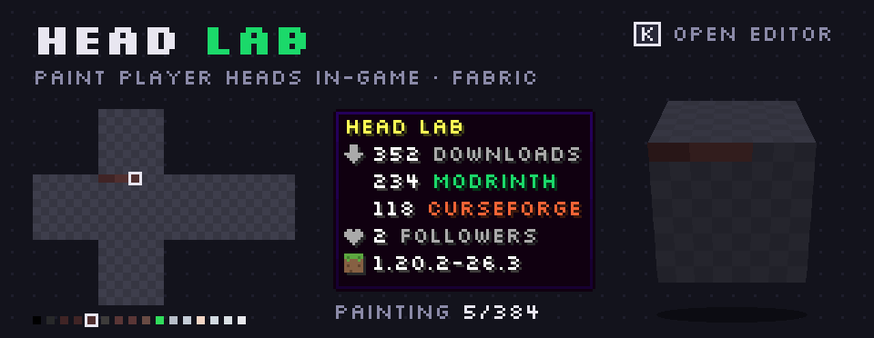
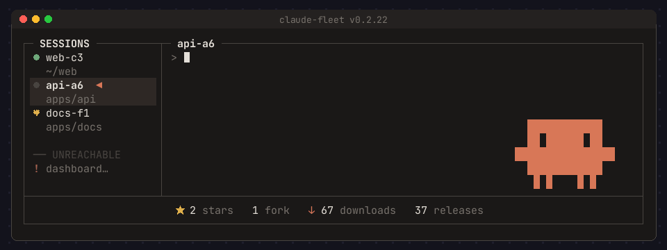

<h1 align="center">Hi, I'm Sowiasty</h1>

  I make games that run in a browser tab, Minecraft mods, and tools for working with Claude Code. 
  Poland · open to work

---

### 🐎 Nomads: tribe wars in your browser

Lead a tribe on horseback: gather, build, invent and fight the other tribes. Free, nothing to install, and it plays on a phone too.

**[▶ Play at nomads.sowiasty.dev](https://nomads.sowiasty.dev)** · [Discord](https://discord.gg/QE3fhBa5s)

### 🧑‍🎨 Head Lab

An in-game custom player head editor for Fabric. Press <kbd>K</kbd>, paint all six faces on a pixel net, watch the live 3D preview, and the head lands in your inventory, on any server, with no OP, plugins or commands.

Get it on **[Modrinth](https://modrinth.com/mod/head-lab)** or **[CurseForge](https://www.curseforge.com/minecraft/mc-mods/head-lab)**.

### 🦀 claude-fleet

A terminal multiplexer for Claude Code sessions, written in Rust: the session list on the left, the full interactive terminal of the selected session on the right, and Clawd dancing in the corner. Windows and macOS.

Unofficial: not affiliated with or endorsed by Anthropic. "Claude" and "Claude Code" are trademarks of Anthropic.

---

<picture>
  <source media="(prefers-color-scheme: dark)" srcset="https://raw.githubusercontent.com/Sowiastyy/Sowiastyy/output/snake-dark.svg">
  
</picture>
